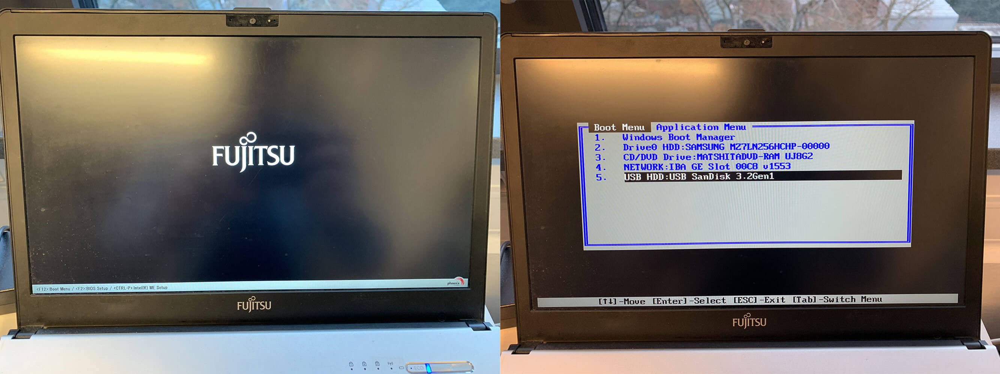
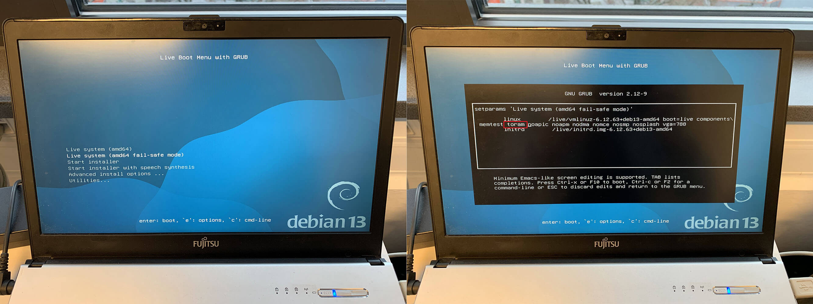
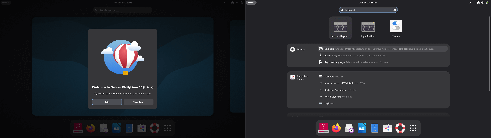
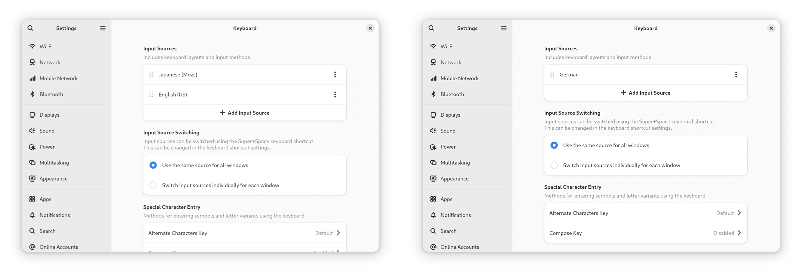
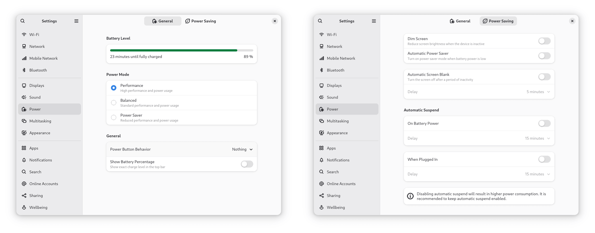
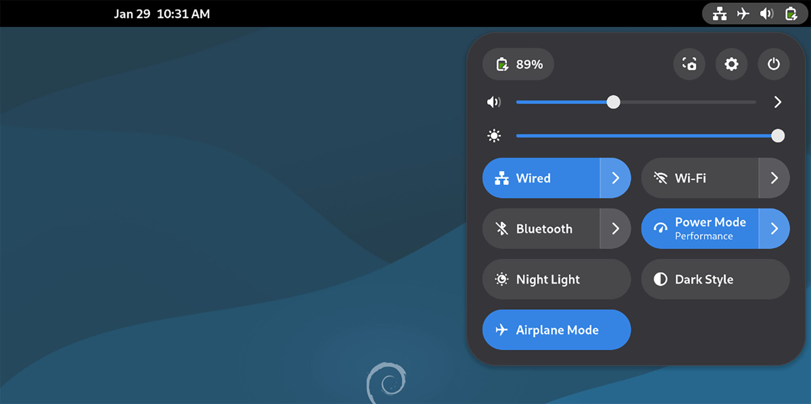

# EchoStreamer

The EchoStreamer tool enables testing out different audio echo scenarios within a standard voice call between two participants. In addition to hearing the remote participant, each participant also hears their own voice with a configurable echo latency and gain. The latency is precisely controllable from 20ms upwards. During each EchoStreamer session, audio from both participants microphone-input and headphones-output is recorded, allowing for subsequent analysis of the call.

## 1) Setting up the test machines

### 1.1) Booting Debian

As EchoStreamer expects a Debian Linux environment, please first make sure to have a USB thumb drive flashed with Debian plugged into the computer. Start the machine and enter the BIOS boot selection menu prior to Windows startup. On the QU Lab's Fujitsu Lifebook laptops, this is typically archived by pressing the `F12` key.



Select "Live System (Failsafe mode)" on Debian's pre-boot menu and press the `e` key to change the GRUB boot parameters. Make sure to include a `toram` parameter so that the entirety of your USB thumb drive is loaded into memory. This allows the thumb drive to be removed from the computer after the boot process has been finished.



Then press F10 to begin the boot process. This typically takes about three minutes.

### 1.2) Setting up Debian

After Debian is booted up, you are greeded by a "Take a Tour"-window, which you can click away.

Proceed by moving up your mouse cursor to the top-left corner and type "Keyboard" and then select the "Keyboard" result within the "Settings" section.



Click on "Add Input Source" and select a German Keyboard layout. You can now delete the "Japanese (Mozc)" and "English (US)" entries.



Next, move your mouse cursor the top-left corner again and type in "Power", to enable "Performance mode" and disable all power saving settings like so:



Finally, you can also disable WiFi and Bluetooth via the popup box on the upper taskbar.



That should wrap-up the setup process of Debian.

### 1.3) Setting up GStreamer

As EchoStreamer basically is just a script that utilizes GStreamer at its core, please make sure to have GStreamer installed on your machine. Also make sure that the ethernet cable is now plugged into the machine.

Open up a terminal (top-left corner again), change into the root user and install all necessary packages.

```
sudo -i

apt-get -y update
apt-get -y upgrade

apt-get -y install htop nano net-tools

apt-get -y install libgstreamer1.0-dev libgstreamer-plugins-base1.0-dev libgstreamer-plugins-bad1.0-dev gstreamer1.0-plugins-base gstreamer1.0-plugins-good gstreamer1.0-plugins-bad gstreamer1.0-plugins-ugly gstreamer1.0-libav gstreamer1.0-tools gstreamer1.0-x gstreamer1.0-alsa gstreamer1.0-gl gstreamer1.0-gtk3 gstreamer1.0-qt5 gstreamer1.0-pulseaudio
```

## 2) Using EchoStreamer

Each participant in an EchoStreamer session must run both a sender and a receiver instance simultaneously. The sender transmits the participant's audio, while the receiver captures incoming audio streams, including the participant's own voice.

Make sure to first start both sender instances on each participant's machine. Only after that start up both receiver instances.

**Sender command line arguments:**

```
echostreamer_sender.sh --device <ALSA-SOURCE-DEVICE> --peerip <PEER-IP-ADDRESS> --latency <LATENCY>
echostreamer_sender.sh --device hw:2,0 --peerip 192.168.10.100 --latency 50
```

- **--device** Defines which ALSA device should be used as an audio source. Use `arecord -l` to list out all available ALSA source devices. This normally should be your USB/XLR-Interface.
- **--peerip** Defines the IP address to which the sender should stream the audio to. This should be the other participants IP address. Use `ifconfig` on the peer's machine to get the IP address.
- **--latency** Defines the echo latency which the speaker's voice should have. Accurately controllable from 20ms onwards. Integer values in milliseconds are expected.

**Receiver command line arguments:**

```
echostreamer_receiver.sh --device <ALSA-SINK-DEVICE> --gain <GAIN>
echostreamer_receiver.sh --device hw:2,0 --gain 1.0
```

- **--device** Defines which ALSA device should be used as an audio sink. Use `aplay -l` to list out all available ALSA sink devices. This also should be your USB/XLR-Interface.
- **--gain** Defines the echo gain which the speaker's voice should have. Float values from 0.0 to 1.0 are expected.

## 3) Next possible development steps

- Multi platform support: Instead of using the `gst-launch-1.0` binary, use proper GStreamer bindings within a Python environment, perhaps build a GUI with PyQt, easy installability of app and dependencies possible via Conda environment.
- Test out and optimize stability in unfavourable network conditions (e.g. streaming through the internet).
